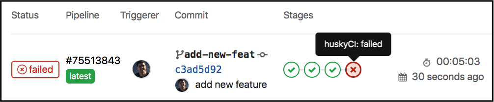

<p align="center">
  
  <!-- logo font: Anton -->
</p>

<p align="center">
  <a href="https://github.com/globocom/huskyCI/releases"></a>
  <a href="https://github.com/rafaveira3/writing-and-presentations/blob/master/DEFCON-27-APP-SEC-VILLAGE-Rafael-Santos-huskyCI-Finding-security-flaws-in-CI-before-deploying-them.pdf"></a>
<a href="https://github.com/rafaveira3/contributions/blob/master/huskyCI-BlackHat-Europe-2019.pdf"></a>
<a href="https://defectdojo.readthedocs.io/en/latest/integrations.html#huskyci-report"></a>
</p>

_This article can also be read in [Brazilian Portuguese](README-ptBR.md)._

## Introduction

huskyCI is an open source tool that orchestrates security tests and centralizes all results into a database for further analysis and metrics. It can perform static security analysis in Python ([Bandit][Bandit] and [Safety][Safety]), Ruby ([Brakeman][Brakeman]), JavaScript ([Npm Audit][NpmAudit] and [Yarn Audit][YarnAudit]), Golang ([Gosec][Gosec]), Java ([SpotBugs][SpotBugs] plus [Find Sec Bugs][FindSec]), and HCL ([TFSec][TFSec]). It can also audit repositories for secrets like AWS Secret Keys, Private SSH Keys, and many others using [GitLeaks][Gitleaks].

## How does it work?

Developers can set up a new stage into their CI pipelines to check for vulnerabilities:

<p align="center"></p>

If security issues are found in the code, the severity, the confidence, the file, the line, and many more useful information can be shown, as exemplified:

```
[HUSKYCI][*] poc-python-bandit -> https://github.com/globocom/huskyCI.git
[HUSKYCI][*] huskyCI analysis started! yDS9tb9mdt4QnnyvOBp3eVAXE1nWpTRQ

[HUSKYCI][!] Title: Use of exec detected.
[HUSKYCI][!] Language: Python
[HUSKYCI][!] Tool: Bandit
[HUSKYCI][!] Severity: MEDIUM
[HUSKYCI][!] Confidence: HIGH
[HUSKYCI][!] Details: Use of exec detected.
[HUSKYCI][!] File: ./main.py
[HUSKYCI][!] Line: 7
[HUSKYCI][!] Code:
6
7 exec(command)
8

[HUSKYCI][!] Title: Possible hardcoded password: 'password123!'
[HUSKYCI][!] Language: Python
[HUSKYCI][!] Tool: Bandit
[HUSKYCI][!] Severity: LOW
[HUSKYCI][!] Confidence: MEDIUM
[HUSKYCI][!] Details: Possible hardcoded password: 'password123!'
[HUSKYCI][!] File: ./main.py
[HUSKYCI][!] Line: 1
[HUSKYCI][!] Code:
1 secret = 'password123!'
2
3 password = 'thisisnotapassword' #nohusky
4

[HUSKYCI][SUMMARY] Python -> huskyci/bandit:1.6.2
[HUSKYCI][SUMMARY] High: 0
[HUSKYCI][SUMMARY] Medium: 1
[HUSKYCI][SUMMARY] Low: 1
[HUSKYCI][SUMMARY] NoSecHusky: 1

[HUSKYCI][SUMMARY] Total
[HUSKYCI][SUMMARY] High: 0
[HUSKYCI][SUMMARY] Medium: 1
[HUSKYCI][SUMMARY] Low: 1
[HUSKYCI][SUMMARY] NoSecHusky: 1

[HUSKYCI][*] The following securityTests were executed and no blocking vulnerabilities were found:
[HUSKYCI][*] [huskyci/gitleaks:2.1.0]
[HUSKYCI][*] Some HIGH/MEDIUM issues were found in these securityTests:
[HUSKYCI][*] [huskyci/bandit:1.6.2]
ERROR: Job failed: exit code 190
```

## Getting Started

You can try huskyCI by setting up a local environment using Docker Compose following [this guide](https://huskyci.opensource.globo.com/docs/quickstart/local-installation/).

## Documentation

All guides and the full documentation can be found in the [official documentation page](https://huskyci.opensource.globo.com/docs/quickstart/overview).

## Contributing

Read our [contributing guide](https://github.com/globocom/huskyCI/blob/master/CONTRIBUTING.md) to learn about our development process, how to propose bugfixes and improvements, and how to build and test your changes to huskyCI.

## Troubleshooting

If you encounter a problem, please reach out to us at [GitHub Issues](https://github.com/globocom/huskyCI/issues) or [Gitter](https://gitter.im/globocom/huskyCI). And if you have found a solution for a commom problem, please add the problem and the solution Hher

## Communication

We have a few channels for contact, feel free to reach out to us at:

- [GitHub Issues](https://github.com/globocom/huskyCI/issues)
- [Gitter](https://gitter.im/globocom/huskyCI)
- [Twitter](https://twitter.com/huskyCI)

## Contributors

<!-- CONTRIBUTORS_START -->
<table><tr><td align="center"><a href="https://github.com/rafaveira3"><br>rafaveira3</a></td><td align="center"><a href="https://github.com/Krlier"><br>Krlier</a></td><td align="center"><a href="https://github.com/spimpaov"><br>spimpaov</a></td><td align="center"><a href="https://github.com/joserenatosilva"><br>joserenatosilva</a></td><td align="center"><a href="https://github.com/gabriel-cantergiani"><br>gabriel-cantergiani</a></td></tr><tr><td align="center"><a href="https://github.com/marcelomagina"><br>marcelomagina</a></td><td align="center"><a href="https://github.com/nettoclaudio"><br>nettoclaudio</a></td><td align="center"><a href="https://github.com/edersonbrilhante"><br>edersonbrilhante</a></td><td align="center"><a href="https://github.com/GabhenDM"><br>GabhenDM</a></td><td align="center"><a href="https://github.com/mdjunior"><br>mdjunior</a></td></tr><tr><td align="center"><a href="https://github.com/fguisso"><br>fguisso</a></td><td align="center"><a href="https://github.com/vitoriario"><br>vitoriario</a></td><td align="center"><a href="https://github.com/rodrigo-brito"><br>rodrigo-brito</a></td><td align="center"><a href="https://github.com/gustavocovas"><br>gustavocovas</a></td><td align="center"><a href="https://github.com/abzcoding"><br>abzcoding</a></td></tr><tr><td align="center"><a href="https://github.com/lzakharov"><br>lzakharov</a></td><td align="center"><a href="https://github.com/itepifanio"><br>itepifanio</a></td><td align="center"><a href="https://github.com/victorpalmeira"><br>victorpalmeira</a></td><td align="center"><a href="https://github.com/meltedblocks"><br>meltedblocks</a></td><td align="center"><a href="https://github.com/localleon"><br>localleon</a></td></tr><tr><td align="center"><a href="https://github.com/jimmy1134"><br>jimmy1134</a></td><td align="center"><a href="https://github.com/henriquebonadio-zz"><br>henriquebonadio-zz</a></td><td align="center"><a href="https://github.com/vfiebig"><br>vfiebig</a></td><td align="center"><a href="https://github.com/gitter-badger"><br>gitter-badger</a></td><td align="center"><a href="https://github.com/renatoaquino"><br>renatoaquino</a></td></tr><tr><td align="center"><a href="https://github.com/RayTdC"><br>RayTdC</a></td><td align="center"><a href="https://github.com/rafaelrubbioli"><br>rafaelrubbioli</a></td><td align="center"><a href="https://github.com/rafaelsq"><br>rafaelsq</a></td><td align="center"><a href="https://github.com/ragoso"><br>ragoso</a></td><td align="center"><a href="https://github.com/aranhams"><br>aranhams</a></td></tr></table>
<!-- CONTRIBUTORS_END -->

This project exists thanks to all the [contributors](<(https://github.com/globocom/huskyCI/graphs/contributors)>). You rock! ❤️🚀

## License

huskyCI is licensed under the [BSD 3-Clause "New" or "Revised" License](https://github.com/globocom/huskyCI/blob/master/LICENSE.md).

[Bandit]: https://github.com/PyCQA/bandit
[Safety]: https://github.com/pyupio/safety
[Brakeman]: https://github.com/presidentbeef/brakeman
[Gosec]: https://github.com/securego/gosec
[NpmAudit]: https://docs.npmjs.com/cli/audit
[YarnAudit]: https://yarnpkg.com/lang/en/docs/cli/audit/
[Gitleaks]: https://github.com/zricethezav/gitleaks
[SpotBugs]: https://spotbugs.github.io
[FindSec]: https://find-sec-bugs.github.io
[TFSec]: https://github.com/liamg/tfsec
